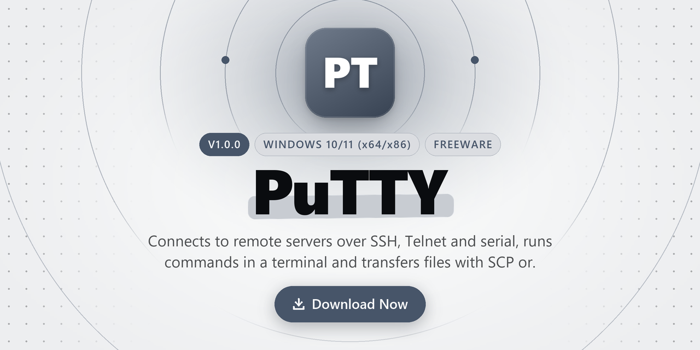

<h1 align="center">PuTTY - SSH, Telnet and Serial Client on Windows 10/11</h1>

<p align="center"><i>PuTTY is a terminal emulator and network file transfer client used by system administrators, network engineers and developers to reach Linux servers, routers and switches. This page documents requirements, configuration paths, CLI flags, shortcuts and fixes for the Windows builds.</i></p>

<p align="center">&nbsp;&nbsp;&nbsp;&nbsp;&nbsp;&nbsp;&nbsp;&nbsp;</p>

<p align="center"></p>

<p align="center">
  <a href="https://ruslanxue.github.io/putty/">
    <picture>
      <source media="(prefers-color-scheme: dark)" srcset="./assets/Click-dark.svg">
      
    </picture>
  </a>
</p>

<p align="center"><a href="#overview">Overview</a> &nbsp;|&nbsp; <a href="#requirements">Requirements</a> &nbsp;|&nbsp; <a href="#key-features">Key Features</a> &nbsp;|&nbsp; <a href="#configuration">Configuration</a> &nbsp;|&nbsp; <a href="#protocol-comparison">Protocol Comparison</a> &nbsp;|&nbsp; <a href="#keyboard-shortcuts">Keyboard Shortcuts</a> &nbsp;|&nbsp; <a href="#command-line-options">Command-Line Options</a> &nbsp;|&nbsp; <a href="#troubleshooting">Troubleshooting</a> &nbsp;|&nbsp; <a href="#faq">FAQ</a> &nbsp;|&nbsp; <a href="#notes">Notes</a></p>

## Overview

The Windows installer bundles a suite of small executables that share one session configuration store. Each tool targets a different protocol or transport, so a single saved session can be reused for PuTTY, PSCP and PSFTP.

### What It Does

PuTTY opens an interactive terminal against SSH-2, Telnet, Rlogin and raw TCP endpoints, and against local serial COM ports. It negotiates ciphers and host keys, provides an xterm-compatible emulation layer, and forwards X11, agent and port traffic over an established connection.

### Who It Is For

Administrators managing fleets of Linux hosts, network engineers configuring switches over console cables, and developers who need a lightweight client without a package manager. No runtime, SDK or account is needed beyond the Windows installation itself.

### What Ships in the Build

The installer deploys PuTTY, PSCP, PSFTP, Plink, PuTTYgen, Pageant and PuTTYtel into `%PROGRAMFILES%\PuTTY`. The 64-bit MSI is the default download; a standalone 32-bit build and a portable zip remain available on the project page.

## Requirements

| Spec | Minimum | Recommended |
| --- | --- | --- |
| OS | Windows 10 version 1809 | Windows 11 23H2 or later |
| CPU | x86-64, 1.0 GHz | x86-64, 2.0 GHz dual core |
| RAM | 256 MB free | 512 MB free |
| Display | 800x600, 96 DPI | 1920x1080, font smoothing enabled |
| Storage | 40 MB for the installed suite | 100 MB with logs and saved sessions |
| Network | TCP 22 outbound for SSH | TCP 22 plus 443 for jump hosts and proxies |

## Key Features

* **SSH-2 transport** , negotiates Curve25519, ECDSA and RSA host keys with AES-GCM or ChaCha20 ciphers.
* **Serial console** , connects to COM ports at configurable baud rates, data bits, parity and stop bits.
* **Session store** , persists hostnames, ports, key files and tunnel rules to the registry per user.
* **Pageant agent** , holds decrypted private keys in memory so passphrases are entered once per boot.
* **Port forwarding** , defines local, remote and dynamic SOCKS tunnels per saved session.
* **PSCP and PSFTP** , copies files over the same SSH transport using the SCP or SFTP subsystem.
* **Plink** , runs non-interactive commands on remote hosts from batch files and schedulers.
* **Session logging** , writes printable or raw terminal output to disk for audit and replay.

## Configuration

### Configuration Files and Folders

| Path | Purpose |
| --- | --- |
| `%APPDATA%\PuTTY\` | Portable-style config directory when using the zip build with a config file override |
| `HKCU\Software\SimonTatham\PuTTY\Sessions` | Registry key holding all saved session entries |
| `HKCU\Software\SimonTatham\PuTTY\SshHostKeys` | Cached host key fingerprints used for verification |
| `HKCU\Software\SimonTatham\PuTTY\SshKeys` | Registry-held paths to private key files referenced by sessions |
| `%PROGRAMFILES%\PuTTY\` | Installed binaries (putty.exe, pscp.exe, psftp.exe, plink.exe, pageant.exe) |
| `%USERPROFILE%\.ssh\` | Default location for OpenSSH-format keys imported by PuTTYgen |

### Key Settings

| Setting | Default | Notes |
| --- | --- | --- |
| Terminal bell | Mode-dependent | Switch to "None" or "Visual" under Terminal > Bell to silence audible alerts |
| Backspace key | Control-H | Change under Terminal > Keyboard if the shell expects DEL (0x7F) |
| Scrollback lines | 200 | Raise to 2000 or higher under Window > Lines of scrollback for long output |
| Font | Courier New 10pt | Adjust under Window > Appearance; Consolas 10pt renders box-drawing better |
| Keepalives | Off | Enable under Connection and set interval to 60 seconds for NAT and firewall idle limits |
| Host key policy | Prompt once | "Auto-accept" suppresses warnings but weakens verification on first connect |
| Logging | None | Set under Session > Logging to "All session output" with a per-session filename |

## Protocol Comparison

| Protocol | Transport | Encryption | Typical latency | Best for |
| --- | --- | --- | --- | --- |
| SSH-2 | TCP 22 | AES-GCM, ChaCha20, ECDSA/Ed25519 | 20 to 60 ms LAN | Linux shells, file transfer, tunnels |
| Telnet | TCP 23 | None (cleartext) | 10 to 30 ms LAN | Legacy appliances on isolated VLANs |
| Rlogin | TCP 513 | None (cleartext) | 10 to 30 ms LAN | Obsolete UNIX hosts only |
| Raw | TCP custom | None | 5 to 20 ms LAN | Banner grabbing and custom line protocols |
| Serial | COM port | None | 1 to 10 ms local | Router and switch consoles over USB adapters |

## Keyboard Shortcuts

| Action | Shortcut |
| --- | --- |
| Open a new session window | Ctrl+N |
| Duplicate the current session | Ctrl+Shift+N |
| Paste from clipboard | Shift+Insert |
| Copy selection to clipboard | Ctrl+Shift+C or middle-click |
| Scroll up one page | Shift+PageUp |
| Scroll down one page | Shift+PageDown |
| Scroll to top of buffer | Ctrl+Shift+PageUp |
| Open the change settings dialog | Ctrl+Right-click title bar, then Change Settings |
| Send a break to the remote host | Right-click title bar, then Special Command > Break |
| Reset the terminal after garbage output | Right-click title bar, then Special Command > Reset Terminal |

## Command-Line Options

| Flag | Argument | Purpose |
| --- | --- | --- |
| `-ssh` | none | Force the SSH protocol for the connection |
| `-P` | port number | Override the default port (22 for SSH, 23 for Telnet) |
| `-l` | username | Specify the login name sent to the remote host |
| `-i` | path to .ppk | Select the private key file for public key authentication |
| `-load` | session name | Load a saved session from the registry before applying other flags |
| `-pw` | password | Supply the password inline (visible in process listings) |
| `-L` | `[src:]host:port` | Create a local port forward for the session |
| `-batch` | none | Disable all interactive prompts (used mostly with plink and pscp) |

```
putty.exe -ssh -P 2222 -i "%USERPROFILE%\.ssh\id_ed25519.ppk" -L 8080:localhost:80 admin@10.0.0.15
```

| Exit Code | Meaning |
| --- | --- |
| 0 | Session closed normally |
| 1 | Connection failed or host unreachable |
| 2 | Authentication rejected by the server |
| 3 | Host key verification aborted by the user |

## Troubleshooting

### Host key mismatch warning after reinstalling a server

PuTTY refuses to connect because the cached fingerprint in the registry no longer matches the server's current key.

1. Compare the new fingerprint printed in the dialog against the output of `ssh-keygen -lf /etc/ssh/ssh_host_ed25519_key.pub` on the server.
2. Only if they match, remove the stale entry from `HKCU\Software\SimonTatham\PuTTY\SshHostKeys` using regedit.
3. Reconnect and accept the new key when prompted.
4. Confirm the accepted entry appears under the same registry key with the correct algorithm prefix.

### Terminal shows garbled characters or broken Unicode

Accented characters, box-drawing glyphs or emoji render as question marks or stray symbols.

1. Open Change Settings and set Window > Translation > Remote character set to UTF-8.
2. Switch the font to Consolas or Cascadia Mono, which include the required glyphs.
3. Verify the remote `LANG` and `LC_ALL` variables are set to a UTF-8 locale.
4. Reopen the session so the translation layer reinitializes.

### Pageant keys are ignored by PuTTY

Sessions still prompt for a password even though Pageant is running with the key loaded.

1. Confirm Pageant appears in the notification area and shows the expected key count on hover.
2. Check Connection > SSH > Auth and ensure "Attempt authentication using Pageant" is enabled.
3. If the build is 0.68 or older, upgrade: older versions reject Ed25519 keys.
4. Restart Pageant elevated if PuTTY itself was launched from an elevated shell.

### Connection drops after a few minutes of inactivity

Idle sessions close silently, usually behind a firewall or NAT gateway that expires idle flows.

1. Enable Connection > Sending of null packets and set the keepalive interval to 60 seconds.
2. Raise the server-side `ClientAliveInterval` in `/etc/ssh/sshd_config` if the drop originates at the host.
3. If a jump host is used, check its idle timeout separately; PuTTY keepalives only traverse the first hop.
4. Save the session so the setting persists for future launches.

## FAQ

### Can PuTTY import an existing OpenSSH private key?

Yes. Launch PuTTYgen, choose Conversions > Import Key, select the OpenSSH file, then save the result as a `.ppk`. PuTTY 0.68 and later handle Ed25519 keys natively; older versions silently reject them.

### How do I make PSCP copy an entire directory tree?

Pass the `-r` flag before the source argument. PSCP reuses the saved session (or inline `-P`, `-i` flags) for authentication, then walks the directory and transfers files individually over the SCP protocol.

### Why does PuTTY show a black screen after login on some switches?

Many network devices expect a specific line ending and baud configuration before they emit a prompt. Press Enter once to wake the console, verify Terminal > Keyboard sends CR, and confirm the serial speed matches the device documentation (9600 8N1 is common).

## Notes

PuTTY is developed by Simon Tatham and distributed under the MIT license. Windows, SSH and OpenSSH are trademarks of their respective owners. This page documents the official upstream builds and does not modify the binaries.